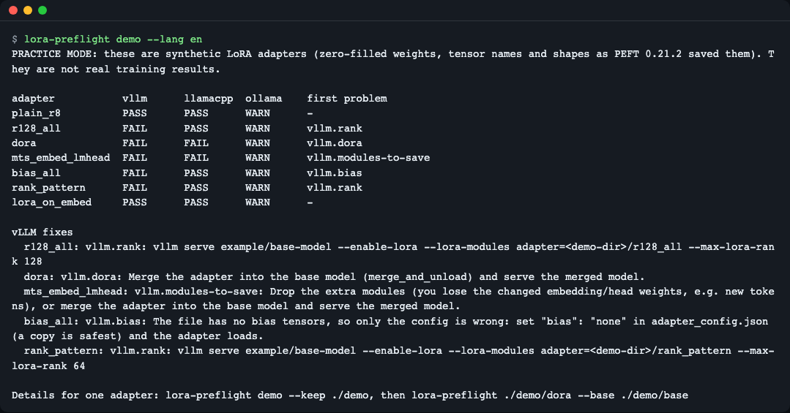
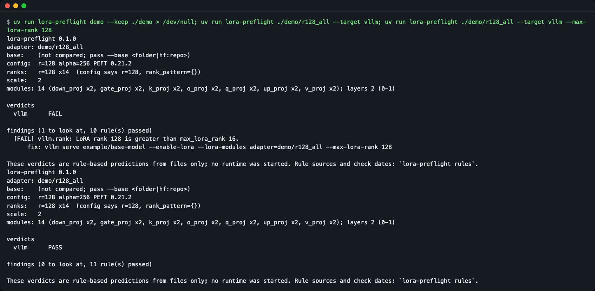
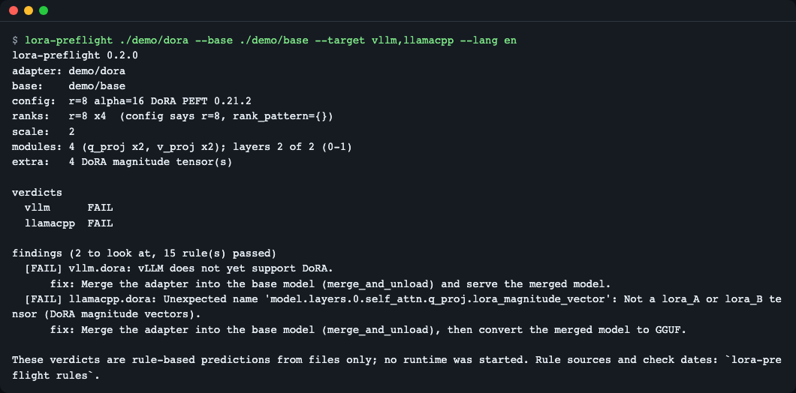
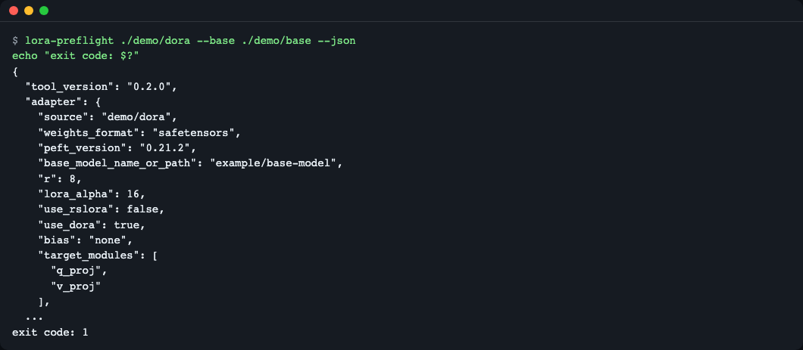
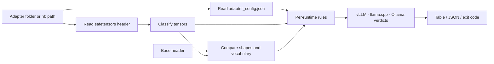
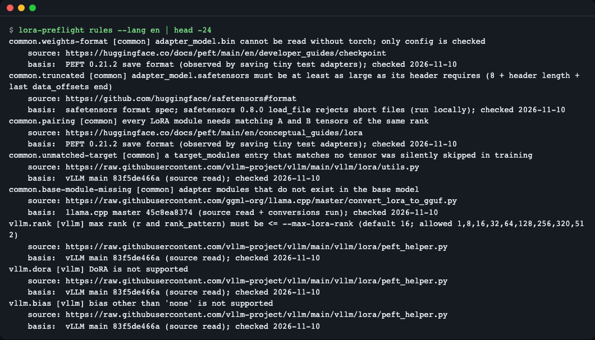

# lora-preflight

[한국어](README.md) | **English**

`lora-preflight` reads a PEFT LoRA adapter's `adapter_config.json` and its safetensors header (never the weights) and predicts, per runtime, whether vLLM, llama.cpp and Ollama will accept it, with a copy-paste fix for each problem. It needs no GPU and no server, and has zero runtime dependencies. Try it: `uvx --from git+https://github.com/LeeGyeongPil/lora-preflight lora-preflight demo` (runs on synthetic practice adapters).

It spares you the annoyance of loading a LoRA fine-tuned adapter onto a server and meeting an error like `LoRA rank 128 is greater than max_lora_rank 16` **only after the server is up**. Point it at an adapter folder and within seconds it tells you pass/fail for vLLM, llama.cpp and Ollama, along with the command to fix it.


*The result of `lora-preflight demo`. A table of 7 synthetic practice adapters checked against vLLM, llama.cpp and Ollama.*

## Who it's for
- You want to serve an adapter trained with PEFT on vLLM or llama.cpp and want to know where it will get blocked before you deploy it
- You want to automatically check the output right after `save_pretrained` in a training pipeline CI
- You want to check only the structure of someone else's adapter from the hub, without downloading the weights

## Installation
```bash
curl -LsSf https://astral.sh/uv/install.sh | sh   # Install uv (skip if you already have it)
uv tool install git+https://github.com/LeeGyeongPil/lora-preflight
lora-preflight --version
```
To use it just once without installing: `uvx --from git+https://github.com/LeeGyeongPil/lora-preflight lora-preflight demo`. Python 3.10 or later is required, and there are no external packages at runtime (standard library only).

> The output in this README was copied from running `uv run lora-preflight …` in the folder where the repo was downloaded. After installing, drop `uv run` and `lora-preflight …` gives the same result.

## Quick start
```bash
lora-preflight demo
```
```
PRACTICE MODE: these are synthetic LoRA adapters (zero-filled weights, tensor names and shapes as PEFT 0.21.2 saved them). They are not real training results.

adapter           vllm      llamacpp  ollama    first problem
plain_r8          PASS      PASS      WARN      -
r128_all          FAIL      PASS      WARN      vllm.rank
dora              FAIL      FAIL      WARN      vllm.dora
mts_embed_lmhead  FAIL      FAIL      WARN      vllm.modules-to-save
bias_all          FAIL      PASS      WARN      vllm.bias
rank_pattern      FAIL      PASS      WARN      vllm.rank
lora_on_embed     PASS      PASS      WARN      -

vLLM fixes
  r128_all: vllm.rank: vllm serve example/base-model --enable-lora --lora-modules adapter=<demo-dir>/r128_all --max-lora-rank 128
  dora: vllm.dora: Merge the adapter into the base model (merge_and_unload) and serve the merged model.
  ...
```
**This is a practice (mock) mode.** These 7 are synthetic adapters we built ourselves. The weights are all zero, but the tensor names, shapes and `adapter_config.json` fields follow the rules PEFT 0.21.2 actually saves. The verdicts in the table are values computed by the real checking rules, not pre-written sentences. On a real adapter the result may differ from what you get by starting a server (see "Limitations" below).

How to read it: `PASS` means no reason to be blocked was found, `FAIL` means that runtime is likely to reject it, and `WARN` means attention is needed. The reason the Ollama column is all WARN is in "Per-runtime rules" below.

To check your own adapter, point it at the folder `save_pretrained` created (`adapter_config.json` + `adapter_model.safetensors`).
```bash
lora-preflight ./out --base ./base-model
```

## Usage

| Command / option | What it does | Example |
|---|---|---|
| `lora-preflight <adapter>` | Checks the adapter and prints a summary, verdicts and fix commands | `lora-preflight ./out` |
| `--base <folder\|hf:repo>` | Compares shapes and vocabulary size against the base model | `--base ./base-model` |
| `--target vllm,llamacpp,ollama` | Choose which runtimes to check (default `all`) | `--target vllm` |
| `--max-lora-rank N` | The `--max-lora-rank` value to give vLLM (default 16) | `--max-lora-rank 64` |
| `--json` | Output as JSON | `--json` |
| `--strict` | Treat WARN as exit code 1 too | `--strict` |
| `lora-preflight demo [--keep DIR]` | Checks 7 synthetic practice adapters; `--keep` keeps the files | `demo --keep ./demo` |
| `lora-preflight rules` | Shows all rules with their sources and check dates | `rules --json` |

Exit codes: `0` no FAIL, `1` FAIL (or WARN under `--strict`), `2` input error (nonexistent folder, etc.).

The scenarios below were run after creating the practice files with `lora-preflight demo --keep ./demo`.

### 1. Rank too large → fix command → pass
```bash
lora-preflight ./demo/r128_all --target vllm
lora-preflight ./demo/r128_all --target vllm --max-lora-rank 128
```

*The first run shows FAIL and the `vllm serve …` command to fix it; the second run applies that value and shows PASS.*
*This screenshot was taken with v0.1.0, so the number of passed rules appears 1 lower because of the `common.truncated` rule added in v0.1.1.*

The key line of the first run is:
```
  [FAIL] vllm.rank: LoRA rank 128 is greater than max_lora_rank 16.
      fix: vllm serve example/base-model --enable-lora --lora-modules adapter=... --max-lora-rank 128
```
vLLM's default `max_lora_rank` is 16, so an adapter with a larger rank only loads if you raise that value. Just paste the `fix:` line. Give `--max-lora-rank 128` and check again, and you get `vllm PASS` (exit code 0).

### 2. Looking inside the adapter, and an unsupported method (DoRA)
```bash
lora-preflight ./demo/dora --base ./demo/base --target vllm,llamacpp
```

*The top is the adapter summary (rank, scale, module count); the bottom is the per-runtime failure reasons and how to fix them.*

The summary block (actual output):
```
config:  r=8 alpha=16 DoRA PEFT 0.21.2
ranks:   r=8 x4  (config says r=8, rank_pattern={})
scale:   2
modules: 4 (q_proj x2, v_proj x2); layers 2 of 2 (0-1)
extra:   4 DoRA magnitude tensor(s)
```
- `ranks` is the actual rank computed from the **tensor shapes**, not from `adapter_config.json`. This is because the config can hide per-layer ranks in `rank_pattern` (the `rank_pattern` practice adapter is such a case).
- `scale` is the effective scale. For plain LoRA it is alpha/r; for rsLoRA it is alpha/√r.
- The DoRA magnitude tensors in `extra` (`lora_magnitude_vector`) are why vLLM and the llama.cpp converter reject it. The fix is to merge the adapter into the base (`merge_and_unload`) and serve the merged model.

### 3. Using it in CI
```bash
lora-preflight ./demo/dora --base ./demo/base --json
echo "exit code: $?"
```

*`--json` prints JSON with `adapter`, `findings` and `verdicts`, and the exit code is 1 if there is a FAIL.*

In a CI step you only need the exit code. Add `--strict` to block on WARN too. In Python you can call the same check as a function.
```python
from lora_preflight import check

report = check("./out", base="./base-model", targets="vllm,llamacpp")
print(report.verdicts)          # A dict like {"vllm": "pass", "llamacpp": "fail"}
for f in report.findings:
    print(f.rule_id, f.status, f.fix)
```

### 4. Checking a hub adapter without downloading it
```bash
lora-preflight hf:smangrul/tinyllama_lora_norobots \
  --base hf:TinyLlama/TinyLlama-1.1B-intermediate-step-1431k-3T --target vllm
```
Give `hf:<owner>/<repo>[@revision]` and it reads only the front part (the header) of the safetensors file with HTTP `Range` requests. Even a base of several GB downloads just a few tens of KB of header. The base of a hub adapter is not fetched automatically, so if you need checks such as vocabulary size you must pass `--base hf:…` yourself. The truncation check (`common.truncated`) uses the total length in the `Content-Range` of the first `Range` response, and is skipped if the total length cannot be known (no extra request).

This is the key output from running the command above against the real hub on 2026-11-10 (hub contents may change). In this example the vocabulary sizes differ (adapter 32005, base 32000), so vLLM comes out `FAIL` and the exit code is 1.
```text
verdicts
  vllm      FAIL

findings (2 to look at, 12 rule(s) passed)
  [FAIL] vllm.embedding-vocab: embedding LoRA size(32005) must be consistent with the base model's vocabulary size(32000) (model.embed_tokens)
  [FAIL] vllm.shape: lm_head: B gives 32005 outputs, base has 32000
```
The unit tests, which run without a network (`tests/test_hub.py`), verify the same path with fake responses.

## Configuration
- There are no required settings or keys. Public hub repos are read without a token.
- `HF_TOKEN`: set it only when reading private or gated repos. The token is not passed to other hosts on CDN redirects.
- `HF_ENDPOINT`: set it when using a hub mirror (default `https://huggingface.co`).

## How it works

1. From the adapter folder it reads only `adapter_config.json` and the **header** of the safetensors file. In safetensors, the first 8 bytes are the header length, followed by that many bytes of JSON (tensor names, shapes, dtypes), so the structure can be known without reading the weights.
2. It classifies by tensor name: `lora_A` and `lora_B`, `lora_embedding_A/B` for embeddings, DoRA magnitude, and modules saved whole via `modules_to_save`.
3. If you gave a base, it compares shapes and vocabulary size against the base header. Without a base, only the rules that need a base become `UNKNOWN`, with no effect on the exit code.
4. The rules (a single file, `rules.py`) produce the per-runtime verdicts and fix commands. The basis for a verdict is the tensor names and shapes, not the config.

### Per-runtime rules summary
`lora-preflight rules` shows each rule's source URL, reference version and check date (values checked as of 2026-11-10).
```bash
lora-preflight rules | head -24
```


(This image is as of v0.1.0, so it lacks the `common.truncated` rule added in v0.1.1. Check the latest list with `lora-preflight rules`.)
*Each rule carries a source and a check date, so you can trace where a verdict came from.*

- **vLLM**: whether the maximum rank is at or below `--max-lora-rank` (default 16), whether DoRA, `bias`, `lora_bias`, special initialization (PiSSA, etc.) and `modules_to_save` (other than classification heads) are unused, and whether the embedding LoRA vocabulary size equals the base's.
- **llama.cpp**: whether `convert_lora_to_gguf.py` can convert it (it aborts if there are tensors other than LoRA A/B, or DoRA magnitude tensors) and whether shapes match the base. If it passes, the conversion and serving commands are shown.
- **Ollama**: on the Ollama 0.40.15 we checked, a Modelfile containing `ADAPTER` failed with `LoRA adapters are no longer supported`. So every adapter is WARN, and the command to merge the adapter into the base and import it with `FROM` is shown. We did not confirm from which version this started, and it may differ in other versions.

## When to use it
- Use it when: right after LoRA or QLoRA training, before deploying to a server, you want to know where it will get blocked without a server or GPU. Or when you want to see an adapter's rank, target modules and save format with your own eyes.
- Scope of this tool: it predicts by rules, looking only at files (config and header). It is not a tool that actually starts a server. Other static checkers include [peft-preflight](https://github.com/thisbejim/peft-preflight) and [peftlint](https://github.com/omar07ibrahim/peftlint); check each project's documentation to compare.
- Other approaches: if you need real serving results, start it yourself with [vLLM](https://docs.vllm.ai/) or [llama.cpp](https://github.com/ggml-org/llama.cpp). For how to create adapters, see the [PEFT documentation](https://huggingface.co/docs/peft).

## Limitations
- It is a rule-based approximation. When runtime versions change the rules may change too, so please look at the check dates in `lora-preflight rules` as well.
- `adapter_model.bin` cannot be read without torch, so only the config is checked.
- vLLM's per-model supported modules are approximated by a table of representative suffixes (`q/k/v/o/gate/up/down_proj`, `embed_tokens`, `lm_head`), and anything outside it is WARN.
- An adapter with `bias=all` but no bias tensors splits: `FAIL` on vLLM, `PASS` on llama.cpp (visible in the `demo` output for the practice adapters). The explanation of adapter structure (the `lora_A`/`lora_B` naming rule, `rank_pattern`) is scattered across "How it works" and `lora-preflight rules`.
- If an `HF_ENDPOINT` mirror ignores `Range` requests and returns the whole file, it may read up to the header length (maximum 100MB) into memory. The main hub server gives partial responses.
- Hub path errors show on screen as `error: hf:... HTTP 401 ...` (`SourceError` is the Python API exception name). A nonexistent repo also comes back as 401 and shows only the private-repo notice, so check the repo name for typos too.
- The loop in the Python example prints even the rules that passed. To see only problems, filter with `if f.status != "pass"`.
- The practice adapters have zero weights, so they do not judge quality or accuracy. They only check structural compatibility.

## Troubleshooting
| Symptom | Cause | Fix |
|---|---|---|
| `error: ... is not a folder` and exit code 2 | The path is not a folder, or a typo | Give the folder containing `adapter_config.json`, or use `hf:<owner>/<repo>` |
| A rule that needs a base is `UNKNOWN` | No `--base`, and the base path in the config does not exist locally | Add `--base ./base-model` or `--base hf:<owner>/<repo>` |
| Ollama is always `WARN` | Importing adapters is blocked in the version we checked | Make a merged model with the merge command shown and use it with `FROM` |
| `SourceError` on a hub path | Wrong repo or file name, private repo, or network | Check the name and set `HF_TOKEN` if it is private |
| `common.truncated` FAIL and exit code 1 | `adapter_model.safetensors` was cut off during copy or upload and is smaller than the header requires | Save again (`save_pretrained`) or copy or download again |
| `error: ... The file is truncated` and exit code 2 (adapter) | The adapter file is cut off inside the header area, so even its size cannot be computed | Same cause as `common.truncated` above, so save again or copy or download again |
| `error: Base file is truncated` and exit code 2 | The `--base` safetensors (or shard) is cut off | Download the base again |
| Exit code 1 with `--strict` | WARN is also treated as failure | To leave Ollama out of the check, use `--target vllm,llamacpp` |

## Development and contributing
```bash
uv sync
uv run pytest -q
```
The tests do not use the network (sockets are blocked). Please leave bugs and suggestions as issues. The change log is [CHANGELOG.md](CHANGELOG.md) (Korean).

## License
MIT. The practice adapters are created by this repo's code and include no separate models or data.
