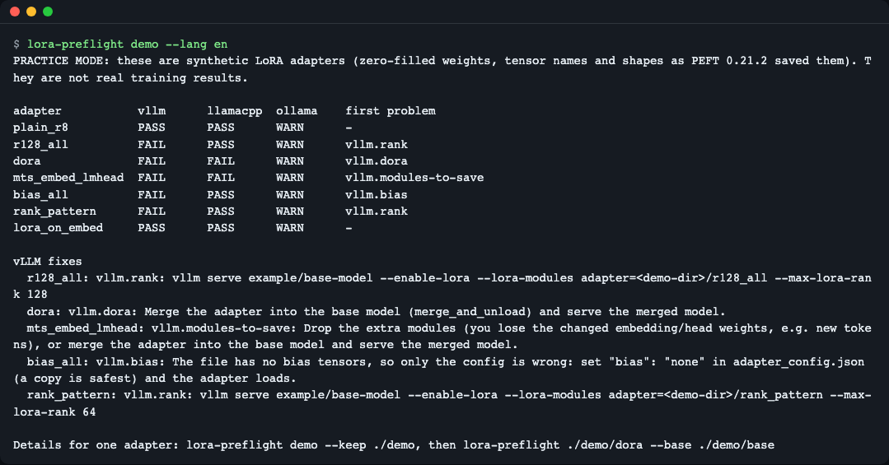
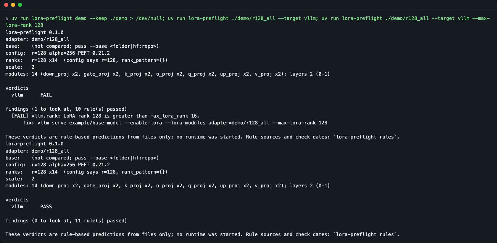
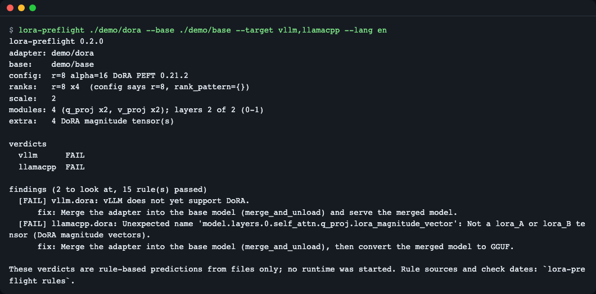
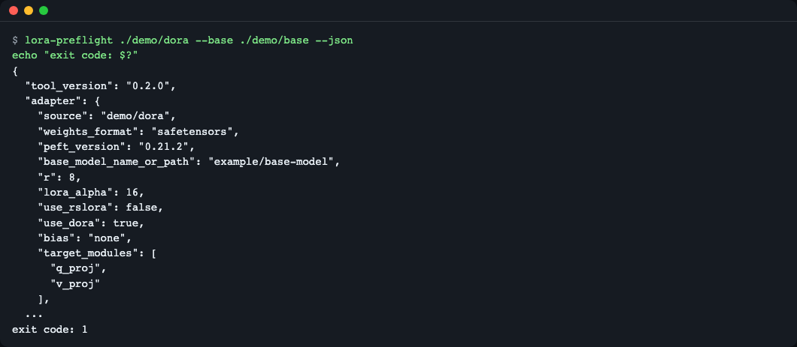
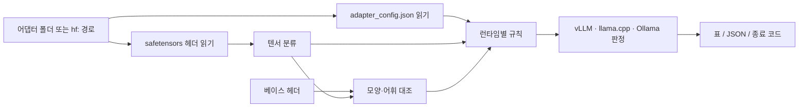
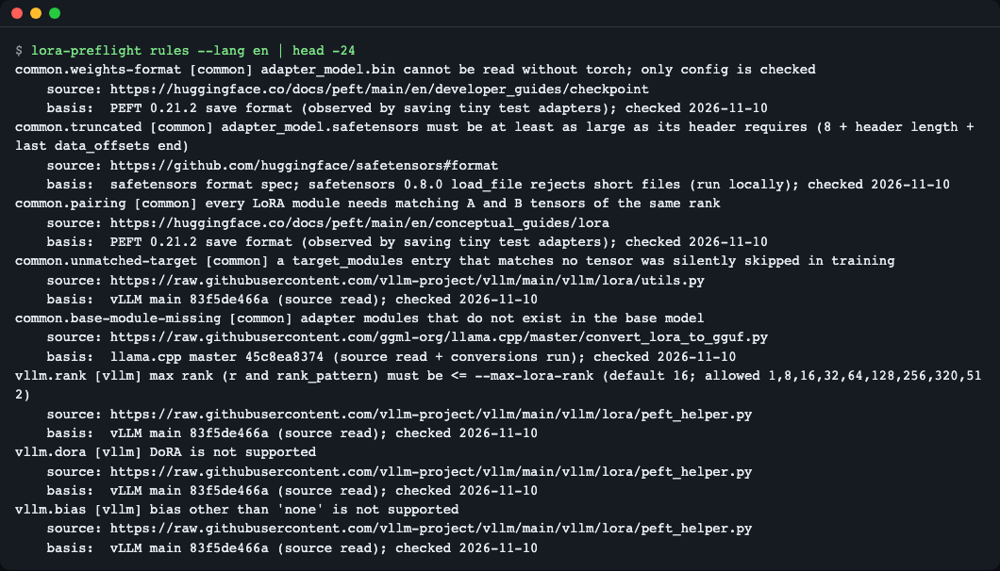

# lora-preflight

> **English summary** — `lora-preflight` reads a PEFT LoRA adapter's `adapter_config.json` and its safetensors header (never the weights) and predicts, per runtime, whether vLLM, llama.cpp and Ollama will accept it, with a copy-paste fix for each problem. It needs no GPU and no server, and has zero runtime dependencies. Try it: `uvx --from git+https://github.com/LeeGyeongPil/lora-preflight lora-preflight demo` (runs on synthetic practice adapters).

LoRA 로 파인튜닝한 어댑터를 서버에 올렸다가 `LoRA rank 128 is greater than max_lora_rank 16` 같은 오류를 **서버를 띄운 뒤에야** 만나는 귀찮음을 없애 줍니다. 어댑터 폴더를 가리키면 몇 초 안에 vLLM·llama.cpp·Ollama 별 통과/실패와 고칠 명령을 알려 줍니다.


*`lora-preflight demo` 의 결과. 연습용 합성 어댑터 7개를 vLLM·llama.cpp·Ollama 기준으로 점검한 표입니다.*

## 이런 분께
- PEFT 로 학습한 어댑터를 vLLM 이나 llama.cpp 로 서빙하려는데, 올리기 전에 막힐 곳을 알고 싶을 때
- 학습 파이프라인 CI 에서 `save_pretrained` 직후 산출물을 자동 검사하고 싶을 때
- 허브에서 남의 어댑터를 받기 전에, 가중치를 내려받지 않고 구조만 확인하고 싶을 때

## 설치
```bash
curl -LsSf https://astral.sh/uv/install.sh | sh   # uv 설치(이미 있으면 생략)
uv tool install git+https://github.com/LeeGyeongPil/lora-preflight
lora-preflight --version
```
설치 없이 한 번만 쓰려면 `uvx --from git+https://github.com/LeeGyeongPil/lora-preflight lora-preflight demo`. Python 3.10 이상이 필요하고, 실행에 쓰는 외부 패키지는 없습니다(표준 라이브러리만 사용).

> 이 README 의 출력은 레포를 내려받은 폴더에서 `uv run lora-preflight …` 로 실행해 복사했습니다. 설치한 뒤에는 `uv run` 을 빼고 `lora-preflight …` 로 같은 결과가 나옵니다.

## 빠르게 시작하기
```bash
lora-preflight demo
```
```
PRACTICE MODE: these are synthetic LoRA adapters (zero-filled weights, tensor names and shapes as PEFT 0.21.2 saved them). They are not real training results.

adapter           vllm      llamacpp  ollama    first problem
plain_r8          PASS      PASS      WARN      -
r128_all          FAIL      PASS      WARN      vllm.rank
dora              FAIL      FAIL      WARN      vllm.dora
mts_embed_lmhead  FAIL      FAIL      WARN      vllm.modules-to-save
bias_all          FAIL      PASS      WARN      vllm.bias
rank_pattern      FAIL      PASS      WARN      vllm.rank
lora_on_embed     PASS      PASS      WARN      -

vLLM fixes
  r128_all: vllm.rank: vllm serve example/base-model --enable-lora --lora-modules adapter=<demo-dir>/r128_all --max-lora-rank 128
  dora: vllm.dora: Merge the adapter into the base model (merge_and_unload) and serve the merged model.
  ...
```
**연습용(mock) 모드입니다.** 이 7개는 직접 만든 합성 어댑터입니다. 가중치는 전부 0이지만 텐서 이름·모양·`adapter_config.json` 필드는 PEFT 0.21.2 가 실제로 저장하는 규칙을 따릅니다. 표의 판정은 미리 써 둔 문장이 아니라 실제 점검 규칙이 계산한 값입니다. 실제 어댑터에서는 서버를 띄운 결과와 다를 수 있습니다(아래 "한계").

읽는 법: `PASS` 는 막힐 이유를 못 찾음, `FAIL` 은 그 런타임이 거부할 가능성이 높음, `WARN` 은 주의가 필요함입니다. Ollama 열이 전부 WARN 인 이유는 아래 "런타임별 규칙"에 있습니다.

내 어댑터를 점검하려면 `save_pretrained` 가 만든 폴더(`adapter_config.json` + `adapter_model.safetensors`)를 가리킵니다.
```bash
lora-preflight ./out --base ./base-model
```

## 사용법

| 명령·옵션 | 하는 일 | 예 |
|---|---|---|
| `lora-preflight <adapter>` | 어댑터를 점검해 요약·판정·수정 명령 출력 | `lora-preflight ./out` |
| `--base <폴더\|hf:repo>` | 베이스 모델과 모양·어휘 크기를 대조 | `--base ./base-model` |
| `--target vllm,llamacpp,ollama` | 점검할 런타임 고르기(기본 `all`) | `--target vllm` |
| `--max-lora-rank N` | vLLM 에 줄 `--max-lora-rank` 값(기본 16) | `--max-lora-rank 64` |
| `--json` | JSON 으로 출력 | `--json` |
| `--strict` | WARN 도 종료 코드 1 로 처리 | `--strict` |
| `lora-preflight demo [--keep DIR]` | 연습용 합성 어댑터 7개 점검, `--keep` 은 파일을 남김 | `demo --keep ./demo` |
| `lora-preflight rules` | 모든 규칙과 출처·확인 날짜 보기 | `rules --json` |

종료 코드: `0` FAIL 없음, `1` FAIL(또는 `--strict` 일 때 WARN), `2` 입력 오류(없는 폴더 등).

아래 시나리오는 `lora-preflight demo --keep ./demo` 로 연습 파일을 만든 뒤 실행한 것입니다.

### 1. 랭크가 너무 큼 → 수정 명령 → 통과
```bash
lora-preflight ./demo/r128_all --target vllm
lora-preflight ./demo/r128_all --target vllm --max-lora-rank 128
```

*첫 실행은 FAIL 과 고칠 `vllm serve …` 명령을, 두 번째 실행은 그 값을 반영해 PASS 를 보여 줍니다.*
*이 화면은 v0.1.0 에서 찍은 것이라 v0.1.1 에서 추가된 `common.truncated` 규칙만큼 통과 규칙 수가 1 적게 보입니다.*

첫 실행의 핵심 줄은 다음과 같습니다.
```
  [FAIL] vllm.rank: LoRA rank 128 is greater than max_lora_rank 16.
      fix: vllm serve example/base-model --enable-lora --lora-modules adapter=... --max-lora-rank 128
```
vLLM 은 기본 `max_lora_rank` 가 16 이라, 더 큰 랭크의 어댑터는 그 값을 올려야 뜹니다. `fix:` 줄을 그대로 붙여 넣으면 됩니다. `--max-lora-rank 128` 을 주고 다시 점검하면 `vllm PASS` (종료 코드 0)가 됩니다.

### 2. 어댑터 안쪽 보기와 지원 안 되는 방식(DoRA)
```bash
lora-preflight ./demo/dora --base ./demo/base --target vllm,llamacpp
```

*위쪽은 어댑터 요약(랭크·스케일·모듈 수), 아래쪽은 런타임별 실패 이유와 고치는 방법입니다.*

요약 블록(실제 출력):
```
config:  r=8 alpha=16 DoRA PEFT 0.21.2
ranks:   r=8 x4  (config says r=8, rank_pattern={})
scale:   2
modules: 4 (q_proj x2, v_proj x2); layers 2 of 2 (0-1)
extra:   4 DoRA magnitude tensor(s)
```
- `ranks` 는 `adapter_config.json` 이 아니라 **텐서 모양**에서 계산한 실제 랭크입니다. config 에는 `rank_pattern` 으로 층마다 다른 랭크가 숨어 있을 수 있기 때문입니다(`rank_pattern` 연습 어댑터가 이 경우입니다).
- `scale` 은 실효 스케일입니다. 일반 LoRA 는 alpha/r, rsLoRA 는 alpha/√r 입니다.
- `extra` 의 DoRA magnitude 텐서(`lora_magnitude_vector`)가 vLLM 과 llama.cpp 변환기가 거부하는 원인입니다. 고치는 방법은 어댑터를 베이스에 병합(`merge_and_unload`)해 병합 모델을 서빙하는 것입니다.

### 3. CI 에서 쓰기
```bash
lora-preflight ./demo/dora --base ./demo/base --json
echo "exit code: $?"
```

*`--json` 은 `adapter`, `findings`, `verdicts` 를 가진 JSON 을 출력하고, FAIL 이 있으면 종료 코드가 1 입니다.*

CI 단계에서는 종료 코드만 쓰면 됩니다. WARN 까지 막으려면 `--strict` 를 붙입니다. 파이썬에서는 같은 점검을 함수로 부를 수 있습니다.
```python
from lora_preflight import check

report = check("./out", base="./base-model", targets="vllm,llamacpp")
print(report.verdicts)          # {"vllm": "pass", "llamacpp": "fail"} 같은 딕셔너리
for f in report.findings:
    print(f.rule_id, f.status, f.fix)
```

### 4. 허브 어댑터를 내려받지 않고 점검하기
```bash
lora-preflight hf:smangrul/tinyllama_lora_norobots \
  --base hf:TinyLlama/TinyLlama-1.1B-intermediate-step-1431k-3T --target vllm
```
`hf:<소유자>/<레포>[@리비전]` 을 주면 HTTP `Range` 요청으로 safetensors 파일 앞부분(헤더)만 읽습니다. 수 GB 짜리 베이스도 헤더 수십 KB 만 받습니다. 허브 어댑터의 베이스는 자동으로 받지 않으므로 어휘 크기 같은 대조가 필요하면 `--base hf:…` 를 직접 줘야 합니다. 잘림 검사(`common.truncated`)는 첫 `Range` 응답의 `Content-Range` 총 길이로 하며, 총 길이를 알 수 없으면 건너뜁니다(추가 요청 없음).

위 명령을 2026-11-10 에 실제 허브에서 실행했을 때의 핵심 출력입니다(허브 내용은 바뀔 수 있습니다). 이 예시는 어휘 크기가 달라(어댑터 32005, 베이스 32000) vLLM 이 `FAIL` 로 나오고 종료 코드는 1 입니다.
```text
verdicts
  vllm      FAIL

findings (2 to look at, 12 rule(s) passed)
  [FAIL] vllm.embedding-vocab: embedding LoRA size(32005) must be consistent with the base model's vocabulary size(32000) (model.embed_tokens)
  [FAIL] vllm.shape: lm_head: B gives 32005 outputs, base has 32000
```
네트워크 없이 도는 단위 테스트(`tests/test_hub.py`)는 가짜 응답으로 같은 경로를 검증합니다.

## 설정
- 필수 설정이나 키는 없습니다. 공개 허브 레포는 토큰 없이 읽습니다.
- `HF_TOKEN`: 비공개·게이트 레포를 읽을 때만 설정합니다. 토큰은 CDN 리다이렉트 때 다른 호스트로 넘기지 않습니다.
- `HF_ENDPOINT`: 허브 미러를 쓸 때 설정합니다(기본 `https://huggingface.co`).

## 동작 원리

1. 어댑터 폴더에서 `adapter_config.json` 과 safetensors 파일의 **헤더**만 읽습니다. safetensors 는 앞 8바이트가 헤더 길이, 이어서 그 길이만큼의 JSON(텐서 이름·모양·dtype)이라, 가중치를 읽지 않아도 구조를 알 수 있습니다.
2. 텐서 이름으로 분류합니다: `lora_A`·`lora_B`, 임베딩용 `lora_embedding_A/B`, DoRA magnitude, `modules_to_save` 로 통째 저장된 모듈.
3. 베이스를 줬다면 베이스 헤더와 모양·어휘 크기를 대조합니다. 베이스가 없으면 베이스가 필요한 규칙만 `UNKNOWN` 이 되고 종료 코드에는 영향이 없습니다.
4. 규칙(`rules.py` 한 파일)이 런타임별 판정과 수정 명령을 만듭니다. 판정의 기준은 config 가 아니라 텐서 이름·모양입니다.

### 런타임별 규칙 요약
규칙마다 출처 URL·기준 버전·확인 날짜를 `lora-preflight rules` 가 보여 줍니다(2026-11-10 기준으로 확인한 값).
```bash
lora-preflight rules | head -24
```


(이 그림은 v0.1.0 기준이라 v0.1.1 에서 추가된 `common.truncated` 규칙이 빠져 있습니다. 최신 목록은 `lora-preflight rules` 로 확인하세요.)
*각 규칙에 출처와 확인 날짜가 붙어 있어, 판정이 어디서 왔는지 따라갈 수 있습니다.*

- **vLLM**: 최대 랭크가 `--max-lora-rank`(기본 16) 이하인지, DoRA·`bias`·`lora_bias`·특수 초기화(PiSSA 등)·`modules_to_save`(분류 헤드 제외)를 쓰지 않았는지, 임베딩 LoRA 어휘 크기가 베이스와 같은지.
- **llama.cpp**: `convert_lora_to_gguf.py` 가 변환할 수 있는지(LoRA A/B 가 아닌 텐서나 DoRA magnitude 가 있으면 중단), 베이스와 모양이 맞는지. 통과하면 변환·서빙 명령을 안내합니다.
- **Ollama**: 확인한 Ollama 0.40.15 에서는 `ADAPTER` 가 든 Modelfile 이 `LoRA adapters are no longer supported` 로 실패했습니다. 그래서 모든 어댑터가 WARN 이고, 어댑터를 베이스에 병합한 뒤 `FROM` 으로 가져오는 명령을 안내합니다. 어느 버전부터 그랬는지는 확인하지 못했고 다른 버전에서는 다를 수 있습니다.

## 언제 쓰나
- 이럴 때: LoRA·QLoRA 학습 직후, 서버에 올리기 전에 서버·GPU 없이 막힐 곳을 알고 싶을 때. 어댑터의 랭크·대상 모듈·저장 형식을 눈으로 확인하고 싶을 때.
- 이 도구의 범위: 파일(설정과 헤더)만 보고 규칙으로 예측합니다. 서버를 실제로 띄워 보는 도구가 아닙니다. 다른 정적 검사기로는 [peft-preflight](https://github.com/thisbejim/peft-preflight), [peftlint](https://github.com/omar07ibrahim/peftlint) 가 있으니 각 프로젝트 문서를 확인해 비교해 보세요.
- 이럴 땐 다른 방법: 실제 서빙 결과가 필요하면 [vLLM](https://docs.vllm.ai/) 이나 [llama.cpp](https://github.com/ggml-org/llama.cpp) 로 직접 띄워 보세요. 어댑터를 만드는 법은 [PEFT 문서](https://huggingface.co/docs/peft)를 보세요.

## 한계
- 규칙 기반 근사입니다. 런타임 버전이 바뀌면 규칙도 바뀔 수 있어 `lora-preflight rules` 의 확인 날짜를 함께 봐 주세요.
- `adapter_model.bin` 은 torch 없이 읽을 수 없어 설정만 점검합니다.
- vLLM 의 모델별 지원 모듈은 대표 접미어 표(`q/k/v/o/gate/up/down_proj`, `embed_tokens`, `lm_head`)로 근사하고, 벗어나면 WARN 입니다.
- `bias=all` 인데 bias 텐서가 없는 어댑터는 vLLM 은 `FAIL`, llama.cpp 는 `PASS` 로 갈립니다(연습용 어댑터 `demo` 출력에서 볼 수 있습니다). 어댑터 구조 설명(`lora_A`/`lora_B` 이름 규칙, `rank_pattern`)은 "동작 원리" 와 `lora-preflight rules` 에 흩어져 있습니다.
- `HF_ENDPOINT` 미러가 `Range` 요청을 무시하고 전체를 돌려주면 헤더 길이(최대 100MB)까지 메모리에 읽을 수 있습니다. 허브 본 서버는 부분 응답을 줍니다.
- 허브 경로 오류는 화면에 `error: hf:... HTTP 401 ...` 로 나옵니다(`SourceError` 는 파이썬 API 예외 이름). 존재하지 않는 레포도 401 로 와서 비공개 안내만 나오니 레포 이름 오타도 확인하세요.
- 파이썬 예제의 루프는 통과한 규칙까지 모두 출력합니다. 문제만 보려면 `if f.status != "pass"` 로 거르세요.
- 연습용 어댑터는 가중치가 0이라 품질·정확도는 판단하지 않습니다. 구조 호환성만 봅니다.

## 자주 겪는 문제
| 증상 | 원인 | 해결 |
|---|---|---|
| `error: ... is not a folder` 와 종료 코드 2 | 경로가 폴더가 아니거나 오타 | `adapter_config.json` 이 든 폴더를 주거나 `hf:<소유자>/<레포>` 를 사용 |
| 베이스가 필요한 규칙이 `UNKNOWN` | `--base` 가 없고 config 의 베이스 경로가 로컬에 없음 | `--base ./base-model` 또는 `--base hf:<소유자>/<레포>` 추가 |
| Ollama 가 늘 `WARN` | 확인한 버전에서 어댑터 가져오기가 막힘 | 안내된 병합 명령으로 병합 모델을 만들어 `FROM` 으로 사용 |
| 허브 경로에서 `SourceError` | 레포·파일 이름 오류, 비공개 레포, 네트워크 | 이름을 확인하고 비공개면 `HF_TOKEN` 설정 |
| `common.truncated` FAIL 과 종료 코드 1 | `adapter_model.safetensors` 가 복사·업로드 중 잘려 헤더가 요구하는 크기보다 작음 | 다시 저장(`save_pretrained`)하거나 다시 복사·다운로드 |
| `error: ... The file is truncated` 와 종료 코드 2 (어댑터) | 어댑터 파일이 헤더 영역 안에서 잘려 크기를 계산할 수도 없음 | 위 `common.truncated` 와 같은 원인이니 다시 저장하거나 다시 복사·다운로드 |
| `error: Base file is truncated` 와 종료 코드 2 | `--base` 의 safetensors(또는 샤드)가 잘림 | 베이스를 다시 받기 |
| `--strict` 인데 종료 코드 1 | WARN 도 실패로 처리하기 때문 | Ollama 를 점검 대상에서 빼려면 `--target vllm,llamacpp` |

## 개발·기여
```bash
uv sync
uv run pytest -q
```
테스트는 네트워크를 쓰지 않습니다(소켓을 막아 둡니다). 버그·제안은 이슈로 남겨 주세요. 변경 기록은 [CHANGELOG.md](CHANGELOG.md).

## 라이선스
MIT. 연습용 어댑터는 이 레포의 코드가 생성하며 별도 모델·데이터를 포함하지 않습니다.
